### 👋 Sobre mí

- ☁️ Trabajo con infraestructura en **AWS**: varias cuentas, automatización y monitoreo.
- 🛠️ Me gusta armar herramientas que me saquen trabajo repetitivo de encima.
- 🐧 Linux, contenedores (Docker / Podman), Kubernetes y Ansible en el día a día.

### 🧰 Stack

  
  
  
  
  

  
  
  
  
  

  
  
  
  
  
  
  

### 📫 Contacto

